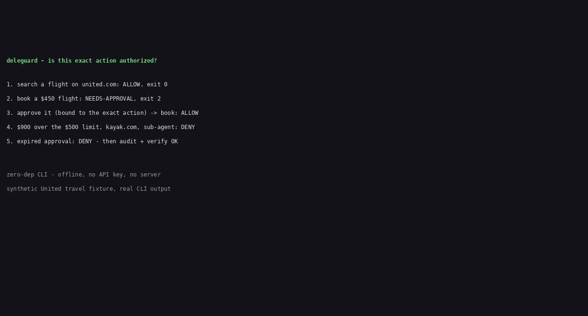

# deleguard

A pre-execution authorization gate for agent actions. For platform and security engineers who let an AI agent propose actions that touch money or customer data. It answers one question, deterministically, before the action runs: is this exact action delegated, in scope, within limits, and approved?

On 11 November 2026 United Airlines said it will bar unauthorized third-party AI agents from booking, changing, or buying tickets (CBS News; Skift; PhocusWire, 11 November 2026). deleguard answers the authorization question on your side of that boundary, before the action runs. It does not help bypass any vendor's rules: it helps a principal enforce their own policy, and helps an operator respect a vendor's.

## Demo



The demo runs the real CLI on the synthetic United travel fixture (see `examples/README.md`): search ALLOW, book NEEDS-APPROVAL, approve, book ALLOW, $900 over the $500 limit DENY, aggregator DENY, sub-agent DENY, expired approval DENY, then audit + verify OK. Full output: [demo/transcript.txt](demo/transcript.txt).

## Why now

An agent can technically book a flight, but having the capability is not having the authority. United's stated reasons are personal-data risk, transactions against the customer's intent, and federal-rule risk (for example an agent checking in luggage without the passenger confirming it holds no prohibited items). Agents may still show flights and prices, and bookings made before 11 November 2026 are not cancelled. United is, per Skift, the first large US carrier to say this explicitly.

## Install (from source)

The npm package is not published yet. Install from source:

```sh
git clone https://github.com/techdevfun/deleguard.git
cd deleguard
npm install
npm run build
```

Then run it with `node dist/cli.js`, or link the binary once:

```sh
npm link   # makes `deleguard` available on your PATH
```

Requires Node.js 20 or newer. Zero runtime dependencies.

## Quick start

```sh
deleguard init
# exit 0 - writes deleguard.json + examples/actions/*.json

deleguard check --policy deleguard.json --action examples/actions/search.json
# VERDICT ALLOW, exit 0

deleguard check --policy deleguard.json --action examples/actions/book.json
# VERDICT NEEDS-APPROVAL, exit 2

deleguard approve --policy deleguard.json --action examples/actions/book.json \
  --by alice --out examples/approvals/appr-1.json
# approval bound to the sha256 of the exact action, 15-minute default expiry

deleguard check --policy deleguard.json --action examples/actions/book.json \
  --approval examples/approvals/appr-1.json --log deleguard-audit.jsonl
# VERDICT ALLOW, exit 0 - the decision is appended to the audit log

deleguard audit --log deleguard-audit.jsonl
deleguard verify --log deleguard-audit.jsonl
# verify OK, exit 0
```

Golden path (init to a verified audit log) takes under 10 minutes.
A clean install from source (npm install + build, no cache) was timed
at 5 seconds on this machine.

## Pre-tool-call hook: gate a real action

`check` answers; the hook in `examples/hook/` enforces the answer
for a scripted agent. It runs a real command ONLY on ALLOW (exit 0):

```sh
bash examples/hook/run-agent.sh
# attempt 1, no approval: NEEDS-APPROVAL blocks the booking write
# human approves the exact action; attempt 2: ALLOW writes the file
# attempt 3, same approval reused: DENY (single-use) blocks the write
```

Or gate any command directly:

```sh
bash examples/hook/pre-tool-call.sh --policy deleguard.json \
  --action examples/actions/book.json \
  --approval examples/approvals/appr-1.json --log deleguard-audit.jsonl \
  -- ./book-flight.sh
# ALLOW -> ./book-flight.sh runs; DENY or NEEDS-APPROVAL -> it never runs.
```

Time to first gated action, measured on this machine on
12 November 2026: about 5 seconds of command time from a source
checkout (`npm install` + build 4.0 s, hook demo 0.9 s), excluding
the time to read the docs. Agent_Sudo documents its own evaluation
path as 5 minutes and tenuo documents its Python quickstart as
5 minutes; we did not re-time their paths ourselves. deleguard is
faster to a first gated action because it does less: no crypto, no
enforcement at a tool boundary, no MCP server. Details and the honest
trade are in [examples/hook/README.md](examples/hook/README.md).

## Worked example

The fixtures in `examples/` are synthetic: Alice, a $500 limit on
united.com, and $450 / $900 amounts are invented to show the decision
rules. They are not United fares, limits, or policy.

```sh
npm run build
node dist/cli.js check --policy examples/deleguard.json \
  --action examples/actions/book-over-limit.json --at 2026-11-12T14:00:00Z
```

```
deleguard check - flight.book

Rule               Result  Detail
------------------------------------------------------------------------
DENIED_TOOL        PASS    tool flight.book is not denied
CHAIN              PASS    every hop has a grant (alice -> travel-agent)
CHAIN_DEPTH        PASS    chain depth 1 fits every grant's maxDepth
CHAIN_SUBSET       PASS    single-hop chain, nothing to subset
TOOL_ALLOWED       PASS    tool flight.book is granted on every hop
TIME_WINDOW        PASS    evaluation time is inside every grant window
AMOUNT             FAIL    amount 900 USD exceeds maxAmount 500 USD of del-1
MERCHANT           PASS    merchant united.com is allowlisted on every hop
DATA_CLASSES       PASS    data classes fit every grant
APPROVAL_REQUIRED  FAIL    amount 900 USD needs a human approval (threshold exceeded)
------------------------------------------------------------------------
VERDICT DENY (policy e1b4be1df043, action 91971f65c825)
```

## The policy model

A policy (`deleguard.json`, version 1) names principals, agents, and
delegation grants. An action names a principal, an agent, the full
delegation chain, the tool, and (for money tools) amount, currency,
merchant, and data classes.

| Rule | What it checks |
| --- | --- |
| **DENIED_TOOL** | The tool is not on the policy's denied list. |
| **CHAIN** | The chain starts at the principal, ends at the agent, and every hop has a delegation grant. A sub-agent acting without a grant is DENY: no implicit inheritance. |
| **CHAIN_DEPTH** | Hops fit every grant's `maxDepth`. |
| **CHAIN_SUBSET** | Each child grant is a subset of its parent: tools, maxAmount, currency, merchants, data classes, expiry. A child can only narrow authority, never widen it. |
| **TOOL_ALLOWED** | The tool is granted on every hop. |
| **TIME_WINDOW** | The evaluation time sits inside every grant's window. |
| **AMOUNT** | A money tool without an amount is DENY (never assume 0). A present amount must match the grant currency and fit every `maxAmount`. |
| **MERCHANT** | Exact-host match against every grant's allowlist. `kayak.com` is not `united.com`; neither is `www.united.com`. |
| **DATA_CLASSES** | The action's data classes fit every grant. |
| **APPROVAL_REQUIRED** | An amount above a grant's `requireApprovalAbove` needs a human approval. A generic `user_confirmed: true` flag is ignored: it is not an approval. |
| **APPROVAL_VALID** | A supplied approval must match the sha256 of the canonical action JSON plus principal, agent, and tool, be unexpired, and not already used. Single-use is enforced by scanning the audit log at check time. |

Exit codes for `check`: 0 = ALLOW, 1 = DENY, 2 = NEEDS-APPROVAL or
POLICY_ERROR. A malformed policy (unknown tool pattern, `maxAmount < 0`,
`expiresAt <= notBefore`, delegation to an unknown agent, duplicate
delegation id, `defaultDecision` other than `deny`) fails closed with
`POLICY_ERROR` and no verdict. Anything not explicitly permitted is
DENY, with the failing rule named.

`approve` issues an approval bound to the exact action (sha256 of the
canonical action JSON). Default expiry is 15 minutes (`--expires-minutes`
to change). It refuses (exit 1) when the action is DENY for
non-approval reasons: an approval cannot launder an over-limit booking,
a wrong merchant, or a missing grant.

`explain` prints the per-rule trace in plain language (exit 0).
`audit` lists decisions from a log file (exit 0; a missing or empty log
is a clear message, not an error). `verify` checks the log's hash chain:
sequence numbers, non-decreasing timestamps, `prevHash` linkage,
recomputed record hashes, one policy hash per policy version, and a scan
for secret-looking values. Exit 0 when clean, 1 with the first bad
record named.

## Performance

One decision (in-process `evaluate` over the six demo actions, 1,000
evals): median 0.014 ms, p95 0.044 ms (median of 3 runs; target was
under 10 ms). Run `npm run bench` to reproduce. The CLI adds process
startup on top of that; the decision itself is sub-millisecond.

## Commands

| Command | What it does |
| --- | --- |
| `deleguard init [--dir <dir>]` | Scaffold `deleguard.json` + 6 example actions. Refuses to overwrite. |
| `deleguard check --policy <f> --action <f> [--approval <f>] [--at <ISO>] [--format table\|json] [--log <f>]` | Answer ALLOW (0), DENY (1), or NEEDS-APPROVAL (2). `--log` appends the decision to an audit log (explicit path only; no silent writes). Using `--approval` without `--log` prints a stderr warning that single-use cannot be checked. |
| `deleguard approve --policy <f> --action <f> --by <human> [--expires-minutes N] [--out <f>]` | Issue an approval bound to the exact action. Default expiry 15 minutes. Refuses a DENY action. |
| `deleguard explain --policy <f> --action <f> [--approval <f>]` | Per-rule trace for one action. Exit 0. |
| `deleguard audit --log <f> [--format table\|json]` | List decisions. Exit 0. |
| `deleguard verify --log <f>` | Check the audit log's hash chain. Exit 0/1. |

## Where rivals beat us

- **tenuo** (tenuo-ai/tenuo, 106 stars, v0.2) is a real delegation system: cryptographic warrants, subtractive delegation across hops, proof-of-possession, signed evidence, Rust/Python/TypeScript SDKs, MCP/A2A/HTTP enforcement. deleguard has no cryptography and no proof-of-possession: it trusts the caller-supplied identity and only decides.
- **Agent_Sudo** (Kisyntra/Agent_Sudo, 5 stars) is an authorization, delegation, provenance, and verifiable-audit engine with an MCP adapter that enforces decisions at the tool boundary and catches prompt-injection by instruction provenance. deleguard does not enforce anything and does not track provenance.
- **DeleGuard** (juliansprt/DeleGuard, 1 star) is a .NET 10 + PostgreSQL platform with an HTTP API, YAML policies, a console, and permits. deleguard is a single zero-dependency CLI with no server and no database.
- **AWS Bedrock AgentCore Policy (Cedar)** gives deterministic Cedar policies with formal analysis tooling and managed scale. deleguard's JSON policy is less expressive and has no symbolic analysis; complex policies belong in Cedar or OPA.
- **Arcade / Composio** hold real OAuth tokens so the model never sees them. deleguard never touches credentials at all.

deleguard's edge is the combination: delegation-first, multi-hop, local, human-readable JSON policy, exact-action approval binding, exit codes a shell or CI step can use directly, no cloud, no gateway, no account, no server.

## Honest limits

- **Identity is a trust assumption, not a feature.** deleguard trusts the caller-supplied principal and agent names. It does not authenticate anyone, and it cannot stop a harness that ignores its verdict or lies about who is calling. The harness must bind identity before calling deleguard.
- **It decides; it does not enforce.** There is no interception, proxy, sandbox, or credential brokering. A verdict is only as strong as the harness that respects it.
- **Single-use approvals rely on the audit log.** Reuse is detected by scanning the log file passed with `--log` at check time. If the operator deletes the log, reuse becomes possible; `verify` reports the sequence gap, and the log must be kept append-only. Without `--log`, reuse cannot be checked at all: `check` then prints a stderr warning when `--approval` is used without `--log`, and the verdict is unchanged (ALLOW stays ALLOW).
- **The audit chain is tamper-evidence, not tamper-proof.** The log is a local file. Anyone who can rewrite the whole file can rebuild the chain. Keep it append-only and check it with `verify`.
- **No bypass, ever.** deleguard is a compliance tool: it helps a principal enforce their own policy and helps an operator respect a vendor's rules. It has no scraping, no browser automation, and no feature that works around a vendor's ban or terms of service.
- **JSON policy, not Cedar/Rego.** The policy language covers the delegation shape (chain, scope, limits, approvals). General authorization with symbolic analysis belongs in Cedar or OPA, linked above.
- **No identity provider, no multi-tenant mode, no notifications.** Single-operator / small-team phase 1. A generic webhook on DENY is roadmap.
- **The United story is a news hook, not a partnership.** deleguard has no relationship with United Airlines, and the fixture's Alice, $500 limit, and $450 / $900 amounts are invented. Sources and dates are in the README so the news claim can be re-checked.

## Roadmap

- Generic webhook on DENY (phase 2).
- MCP gateway adapter (publish the decision as a pre-tool-call check).
- Cedar/Rego import for policies that outgrow JSON.
- `--watch` mode: re-check an action file on every change during development.

## License

MIT. See [LICENSE](LICENSE).
